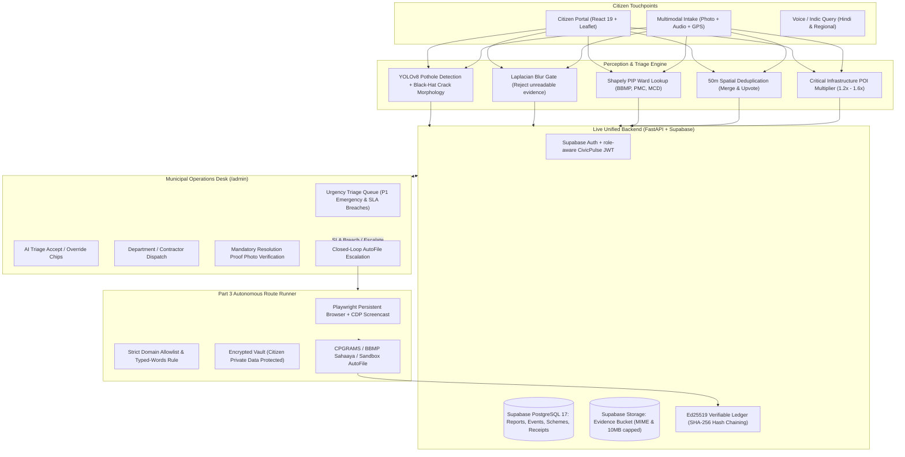

# CivicPilot: Unified Autonomous Civic Governance Platform

CivicPilot is an end-to-end, privacy-preserving, AI-assisted civic platform unifying:
1. **Multilingual Welfare Scheme Explainer & Eligibility Matching (Part 1)**
2. **Multimodal Civic Grievance Triage, GIS Routing & Municipal Operations Desk (Part 2)**
3. **Assisted Execution Agent with Tamper-Evident Ed25519 Cryptographic Receipts (Part 3)**

Backed by a live **Supabase PostgreSQL 17** database, **Supabase Evidence Storage**, and offline-first perception models (**YOLOv8**, **OpenCV crack morphology**, **Shapely GIS**), CivicPilot ensures **Zero Dummy Data**, **Zero Disguised Video Demos**, and **Full Human-in-the-Loop Accountability**.

---

## Architecture Overview



---

## Key Modules & Capabilities

### 1. Municipal Operations Desk (`/admin`)
- **Two-Role Governance:** Citizen view for reporting and public accountability; Municipal Admin view for operations (`admin@demo.in`).
- **Urgency Queue:** Automatically sorts civic reports by severity ($P1 > P2 > P3$) and remaining SLA hours. Real-time red alerts for SLA-breached emergencies.
- **AI Triage Accept / Override:** Officers can review and override AI-assigned categories, severity ratings, or ward boundaries with an auditable trail.
- **Mandatory Proof Photo Resolution:** Contractors cannot fraudulently close tickets without uploading an inspection proof photo. The system validates MIME, extension, and file size before marking a ticket `RESOLVED`.
- **Closed-Loop AutoFile Escalation:** 1-click hand-off of neglected or high-severity grievances to the Part 3 Execution Agent.

### 2. Multimodal Perception & GIS Triage Engine
- **YOLOv8 Pothole Detection (`pothole_best.pt`):** Detects road craters and calculates detection confidence.
- **Black-Hat Morphological Filter:** Analyzes asphalt fissure patterns and crack surface percentages using morphological top-hat kernels.
- **Laplacian Blur Rejection:** Filters out motion-blurred photos ($Var < 80$) before wasting LLM inference.
- **Shapely Point-In-Polygon (PIP) Ward Mapping:** Accurate boundary lookups across Bangalore BBMP (198 wards), Pune PMC, and Delhi MCD GeoJSON boundaries.
- **50-Meter Spatial Deduplication:** Reports within 50 meters in the same category are merged with the parent ticket and upvoted, eliminating duplicate contractor billing.
- **Critical Infrastructure Multiplier:** Proximity to schools, hospitals, transit hubs, and flyovers applies a $1.2\times - 1.6\times$ priority multiplier, automatically elevating routine issues near emergency zones to $P1$.

### 3. Assisted Execution Agent & Cryptographic Receipts
- **Playwright Loop with Live CDP Screencast:** Drives real government portals (myScheme, CPGRAMS, BBMP Sahaaya) with real-time frame streaming.
- **Strict Domain Allowlist:** Agent can never navigate off allow-listed public portals.
- **Typed-Words Rule:** Prevents injection attacks; the agent only types keywords from the citizen's request or official choices.
- **Human-in-the-Loop Checkpoints:** Citizen handles OTP, CAPTCHA, and gives final consent before submission.
- **Tamper-Evident Cryptographic Ledger:** Every submission generates an Ed25519 digital signature and links into a hash chain:
  $$\text{ticket\_hash} = \text{SHA256}(\text{canonical\_json}(\text{payload}) \parallel \text{prev\_hash})$$

---

## Live Data & Hackathon Compliance Guarantees

| Rule | Compliance Guarantee |
|---|---|
| **No Dummy Data** | Live connection to Supabase PostgreSQL 17, live Supabase Storage, real India Post PIN code lookups, RBI IFSC records, and OSM Nominatim reverse geocoding. No static mock JSON datasets. |
| **No Pre-Recorded Demos** | 100% live Playwright execution. Replays of previous runs are explicitly stamped with historical recording timestamps. |
| **Tamper-Evident Receipts** | PyNaCl Ed25519 digital signatures and SHA-256 hash chaining prevent retrospective receipt forgery. |
| **Privacy by Construction** | Aadhaar and bank details are stored only in memory in the encrypted Vault and cleared after portal entry. |

---

## Quickstart & Running Locally

### 1. Environment Setup
```bash
# Clone and checkout p3-part2 branch
git checkout p3-part2

# Install dependencies using uv
uv sync
```

### 2. Configure Environment (`.env`)
Ensure `.env` contains your Supabase credentials:
```bash
DATABASE_URL=postgresql://postgres.<project-ref>:<password>@<pooler-host>:5432/postgres
SUPABASE_URL=https://<project-ref>.supabase.co
SUPABASE_KEY=sb_secret_...
SUPABASE_BUCKET=evidence
DATABASE_MODE=supabase
```

### 2a. Configure account access

Citizen registration and sign-in use Supabase Auth with email and password. In the Supabase dashboard, add your local or deployed sign-in page (for example, `http://localhost:5173/signin`) to **Authentication → URL Configuration → Redirect URLs**. Hosted projects with email confirmation enabled will ask the citizen to verify their email before their first sign-in.

Municipal accounts cannot self-register from the portal. Create or invite the officer in Supabase Auth, then give the matching CivicPulse profile the `admin` role. The seeded `admin@demo.in` record remains only an automated-test fixture; it is not a public municipal credential.

### 3. Seed Live Database (Idempotent)
Populates demo users, 18 realistic ward reports, an SLA breach, a deduplicated pair, and a signed receipt:
```bash
uv run python -m server.seed
```

### 4. Run the Servers
```bash
# Terminal 1: Backend API + Agent Server (port 8000)
uv run uvicorn executor.api:app --port 8000

# Terminal 2: Sandbox Grievance Portal (port 8100)
uv run uvicorn sandbox_portal.app:app --port 8100

# Terminal 3: React Web Frontend (port 5173)
cd web && npm run dev
```

Visit `http://localhost:5173` to explore the unified platform!

---

## 3-Minute Judging Demo Flow

1. **Public Accountability Board (`/board`):**
   - Show live aggregation metrics from Supabase: 18 live tickets, P1 emergency count, and SLA breach tracker.
   - Show Leaflet map with color-coded severity pins across Bangalore, Pune, and Delhi.

2. **Citizen Grievance Intake with AI Triage (`/grievance`):**
   - Drop a pin on Paud Road, Pune or St. Joseph's Hospital, Bangalore.
   - Upload pothole photo: Watch YOLOv8 pothole detection, crack morphology, and POI multiplier calculate severity and SLA in real time.
   - Submit report within 50m of existing crater: Demonstrate automatic 50m spatial deduplication (merge & upvote).

3. **Municipal Operations Desk (`/admin`):**
   - From the public landing page, choose **Municipal desk** and sign in with a provisioned municipal officer account. The desk is not exposed in the public navigation, and protected API actions still require an admin JWT.
   - Review the Triage Queue sorted by urgency: point out the red-flashing P1 emergency (SLA breached).
   - Test "Resolve with Proof Photo": demonstrate that closure is blocked without uploading an inspection proof photo.
   - Click "AutoFile CPGRAMS": Escalate ticket directly to the Part 3 Execution Agent.

4. **Autonomous Execution Agent & Verifiable Receipts (`/agent`):**
   - Watch the agent open the portal via Playwright with live CDP screencasting.
   - Inspect the generated Ed25519 cryptographic receipt and verify its SHA-256 hash-chain link via `/api/v1/receipts/verify`.

---

## Test Verification Suite

All 19 test cases pass across the unified platform:
```bash
uv run pytest tests/test_milestone_s.py tests/test_unified_api.py tests/test_autofile_pipeline.py tests/test_console.py -v
```
- `test_milestone_s.py`: Live Supabase connection, storage MIME/size limits, Ed25519 signing & hash-chain tamper detection.
- `test_unified_api.py`: Dual-role JWT auth, public reports/stats, admin queue sorting, scheme matching.
- `test_autofile_pipeline.py`: P2 $\to$ P3 Closed-loop escalation with signed receipts.
- `test_console.py`: Playwright step loop, domain allowlist, typed-words safety rule.
