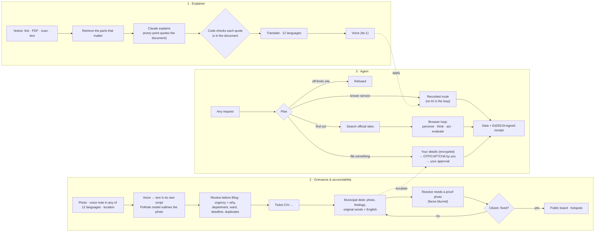

<div align="center">


# Swayam-sevak · स्वयंसेवक

**Understand your rights, report civic problems, and let an agent do the paperwork — in your own language, with you in control.**

**[▶ Try it live](https://anurag137-swayam-sevak.hf.space)** · [What it does](#-what-is-swayam-sevak) · [Results](#-results) · [How it works](#-how-it-works) · [Guardrails](#%EF%B8%8F-guardrails-enforced-in-code) · [Quick start](#-quick-start) · [Deploy](#%EF%B8%8F-deploy) · [Honest limits](#%EF%B8%8F-honest-limits)

[](#-tests)
[](#1-rights--policy-explainer)
[](#1-rights--policy-explainer)
[](#%EF%B8%8F-guardrails-enforced-in-code)

[](#-ai-and-data-sources)
[](#3-autonomous-execution-agent)
[](#-ai-and-data-sources)
[](#-team)

</div>

---

## 💡 What is Swayam-sevak?

India's public services are spread across hundreds of portals and documents: scheme guidelines and Gazette
notifications in dense legal English, multi-page application portals with OTPs and CAPTCHAs, and grievance systems
where complaints disappear without a trace. The people who need them most — first-time internet users, citizens who
read Hindi, Tamil or Bengali rather than English, farmers, older people, small shopkeepers — give up, or pay a
middleman who sees their bank details.

Swayam-sevak closes that gap in three connected parts:

| | Part | What a citizen gets |
|:---:|:---|:---|
| 📜 | **Rights & policy explainer** | Paste any official notice (link, PDF, scan or text). Get your rights, who is eligible, what changes for you and for small businesses, deadlines and next steps — in 12 Indian languages, with a voice. Every point quotes the document. |
| 📍 | **Grievance & public accountability** | Report a problem with a photo and a voice note in your own language. A pothole model marks what it sees, your report becomes a ticket on the municipal desk, the officer gets an English translation, a repair needs a proof photo, and **you confirm whether it is really fixed**. Anyone can follow it on the public board. |
| 🤖 | **Autonomous execution agent** | Ask anything. The agent plans, searches official sites, works a real browser step by step while you watch, and files only after you approve. A signed receipt proves what happened. |

### ▶ Try it

**Live:** https://anurag137-swayam-sevak.hf.space &nbsp;·&nbsp; **Judges:** on *Sign in*, the **Judges' demo** tab enters
the municipal desk or the citizen app in one click (demo accounts made for judging).

> **Not a Government of India website.** A hackathon prototype. The logo and illustrations are original; the national
> emblem is not used.

---

## 🏆 Results

Measured on the **live system** (Claude Opus 5.5 through AIML API, real government sites), 31 Oct – 1 Nov 2026:

<div align="center">

| | |
|:---|:---:|
| **Official documents explained** (web pages, typed PDFs, a scan, Hindi PDFs, a 58-page handbook) | **figures correct in all five** |
| **Unsupported points the AI proposed and code removed** | **0–1 per document** |
| **Free-form agent request, answered from official pages** | **34 s · 6 AI calls** |
| **Known service replayed from a recorded route** (myScheme eligibility, 92 schemes) | **≈10 s · 1 AI call** |
| **Off-limits request refused** (train booking) | **3.5 s · nothing opened** |
| **Voice question → text** (5-second Hindi question) | **8 s, language detected** |
| **Report a problem: Hindi voice note → Hindi text, photo → potholes outlined, → desk ticket with English translation** | **works end to end** |
| **Automated tests** | **110 passing** |

</div>

**Explainer, document by document**

| Document | Output | Time | What it got right |
|:---|:---|:---:|:---|
| myScheme · disability pension page | Hindi | 40 s | Rs. 300/month for a 70-year-old; eligibility yes/unknown from the question |
| PMSBY accident-insurance rules (PDF, jansuraksha.gov.in) | Marathi + audio | 49 s | Rs. 20/year, Rs. 2 lakh cover, ages 18–70, 31 May enrolment |
| Same rules as an image-only scan | Gujarati | 59 s | Same figures, read from page images |
| PMJJBY rules, **Hindi** PDF | English · Bengali | 41 s · 36 s | Ages 18–50, Rs. 436/year, 30-day accident-only rule; clean Hindi quotes |
| POSH Act handbook, 58 pages | Hindi | 71 s | Committee rules for a 12-employee shop, citing pages 20–53 |

### A real answer

> **Document:** PMSBY rules (jansuraksha.gov.in) · **Question:** *"I am 52 and run a small kirana shop with a savings
> account. Can I join and what will my family get?"*
>
> हाँ, शायद आप जुड़ सकते हैं। आपकी उम्र 52 है, जो 18 से 70 के बीच है, और आपका बचत खाता है… हर साल **Rs. 20/-** …
> दुर्घटना में आपकी मौत हो जाए, तो आपके परिवार को **Rs. 2 Lakh** मिलेंगे।
>
> 📖 every point links to its quote and page · 🔊 voice · small-business impact: *none (correctly empty)*

---

## 🧠 How it works



### 1. Rights & policy explainer
- **Retrieval-augmented, grounded.** The document is split into pieces that keep their page numbers; long documents
  are ranked by keywords for the question (no embeddings needed so far). Claude writes rights, eligibility (yes / no /
  unknown against the citizen's own facts), impacts on citizens and small businesses, deadlines and steps.
- **Code, not the AI, decides what is supported.** Every point must carry an exact quote; points whose quote is not in
  the document are dropped and counted.
- **Scans and Indian-script PDFs** are read from page images (their text layers are often garbled, e.g. "ननयम").
- **One language end to end:** answer, headings and voice; the answer follows the language of the question.
- **Ask by voice** on any phone (Whisper), 30 s max, audio not stored.
- **Civic Guide** (signed-in home): answers banking, land, tax and consumer questions only from retrieved official
  pages (GPT-OSS 120B on Groq), and declines when none are found.

### 2. Grievance & public accountability
1. **Speak or type in your language.** A voice note in any of the 12 languages is written down by Whisper (on Groq) in
   its own script, with the language named; the citizen corrects it, and it becomes the report in their own words.
2. **Photo check.** Our YOLOv8 pothole model outlines each pothole on the photo and states what it measured: how
   many, confidence, share of the photo, rough surface, and whether the photo is too blurry. These lines are shown in
   the citizen's language when it is known. No guess goes beyond the numbers.
3. **Review before filing.** Urgency and the reason for it, the department (roads, water, waste, street lighting…),
   the ward (from Bengaluru and Pune ward maps; elsewhere it says "ward not mapped" and keeps the district), the
   deadline, a report already filed within 50 m, and extra priority near schools and hospitals. Nothing is saved yet.
4. **Submit → ticket.** "Submit to the municipal desk" creates a ticket (e.g. `CIV-2FFBECA0`) the desk sees at once.
   Filing it on the grievance portal with the agent is an optional next step.
5. **Municipal desk.** An urgency queue with the citizen's photo (potholes outlined), the photo check, the voice note,
   the original words and an **English machine translation** beside them. Officers override triage with an audit
   trail and **cannot resolve without a proof-of-repair photo**; detected faces in it are blurred and its location
   metadata removed before it is public.
6. **The citizen has the last word.** "Yes, it is fixed" marks the repair *confirmed by the citizen*; "No, still a
   problem" reopens it one priority higher with a 24-hour deadline.
7. **Public board.** Statuses, a map, proof photos, citizen-confirmed repairs and the most-reported wards. Citizens'
   own photos and voice notes stay private (served only to municipal staff from a private bucket).

### 3. Autonomous execution agent
Free-form requests are planned, searched on allow-listed official sites (DuckDuckGo, or the site's own search when
DuckDuckGo shows its bot check, which is never bypassed), and carried out in a real browser one step at a time. Every
step is stored with a screenshot and the agent's state (evaluation, memory, next goal, action) — live, replayable at
1×/2×/5× and always labelled as a replay. A run that works is saved as a **route**: next time it replays in seconds
with no AI. When a portal changes, a healer repairs the broken step and proposes a reviewed patch.

---

## 🛡️ Guardrails, enforced in code

| Guardrail | What it guarantees |
|:---|:---|
| 🌐 **Allow-list** | The browser cannot open a site outside the registry; every redirect is checked |
| ⌨️ **Typed-words rule** | The agent types only words from the citizen's request; private details come from an encrypted vault the AI never sees |
| ✋ **Human steps** | OTPs, CAPTCHAs and choices only the citizen can make are handed to the citizen |
| ✅ **Approval gate** | Final Submit waits for the citizen's yes; payment buttons are never pressed |
| 📖 **Quote check** | An explainer point without a matching quote in the document is removed |
| 🧾 **Signed receipts** | Ed25519-signed, SHA-256 evidence; a receipt is issued only by a real, approved filing |
| 🔐 **Accounts** | Municipal actions need a municipal sign-in; officer accounts need the authority's access code; reports need a signed-in citizen; history is private per account |
| 🙈 **Public photos** | Faces detected in proof photos are blurred and location metadata removed before publishing |
| ✔️ **Citizen sign-off** | Only the person who reported a problem can confirm or dispute its repair |
| 💸 **Cost guard** | Model-backed runs are capped per visitor and per hour |

---

## 🚀 Quick start

**You need:** Python 3.11 with [uv](https://docs.astral.sh/uv/) · Node.js 22 · an AIML API key (Claude, voice, speech) ·
a Supabase project (accounts, reports, evidence storage)

```bash
git clone https://github.com/Kanhaiya76618/civic-pilot.git && cd civic-pilot
uv sync && uv run playwright install chromium
npm --prefix web ci && npm --prefix web run build
cp .env.example .env        # then fill in the keys (see the table below)
```

Run (three terminals):

```bash
uv run uvicorn executor.api:app --port 8000          # API, agent, and the built web app
uv run uvicorn sandbox_portal.app:app --port 8100    # sandbox replica portal used for filings
npm --prefix web run dev                             # optional: hot-reload UI on :5173
```

Open http://localhost:8000. Optional: prepare demo answers with `uv run python scripts/warmup_part1.py`.

| Setting | Purpose |
|:---|:---|
| `AIMLAPI_KEY`, `CIVIC_LLM_PROVIDER=aimlapi` | Claude, voice and speech-to-text |
| `GROQ_API_KEY` (optional `GROQ_MODEL`, default `openai/gpt-oss-120b`; `GROQ_STT_MODEL`, default `whisper-large-v3-turbo`) | Civic Guide; report voice notes and translations — server only, never in browser code or `VITE_*` |
| `SUPABASE_URL`, `SUPABASE_KEY`, `SUPABASE_PUBLISHABLE_KEY`, `SUPABASE_SECRET_KEY`, `DATABASE_URL`, `DATABASE_MODE`, `SUPABASE_BUCKET` | Accounts, reports, private evidence (the secret key creates officer accounts) |
| `CIVIC_OFFICER_SIGNUP_CODE` | Access code for municipal *Create account*; without it, officers cannot sign up |
| `CIVIC_JUDGE_DEMO=1` | Shows the one-click **Judges' demo** tab. Anyone can then act as the demo officer: switch it off after judging |
| `CIVIC_WEBHOOK_SECRET`, `CIVIC_API_KEY`, `CIVIC_VAULT_KEY` | Sign-in tokens, service API, vault encryption — **long random values in any deployment** |
| `CIVIC_PUBLIC_URL`, `CIVIC_DATA_DIR` | Public address; persistent data folder |

Supabase: add your sign-in page (e.g. `http://localhost:8000/signin`) under **Authentication → URL Configuration**.
Municipal officers get the `admin` role as Supabase app metadata (set with the server key, never by the user): they sign
up with the access code, or `uv run python scripts/create_demo_accounts.py --apply` creates the judges' demo officer
and citizen (passwords go to `.data/demo-accounts.txt`, never printed).

---

## ☁️ Deploy

One Docker service serves the website and the API together (same address: no CORS, and the agent's live browser
view needs WebSockets). It needs about **800 MB** of memory during an agent run (640 MB at rest).

**Live on Hugging Face Spaces** (Docker, CPU, port 7860): create a Docker Space, add the settings above under
*Settings → Variables and secrets*, then upload from your machine (`.env` and local data are never uploaded):

```bash
uvx --from huggingface_hub hf auth login
sh deploy/push_to_hf.sh <owner>/<space-name>
```

Add `https://<owner>-<space-name>.hf.space` under Supabase **Authentication → URL Configuration**. The Space's own
disk is wiped on restart: reports, evidence and accounts live in Supabase, but re-run
`uv run python scripts/warmup_part1.py` for the explainer's saved answers. **Render** also works: *Docker*, at least
2 GB, a disk at `/var/data` with `CIVIC_DATA_DIR=/var/data`. Never set `CIVIC_ALLOW_DEMO_LOGIN` in a deployment.

---

## 📊 AI and data sources

| Source | Used for | Live? |
|:---|:---|:---:|
| Claude Opus 5.5 (AIML API) | Explaining, translating, reading scans, planning and agent steps | ✅ |
| OpenAI `tts-1`, Whisper large (AIML API) | Spoken answers, spoken questions in the explainer | ✅ |
| GPT-OSS 120B (Groq) | Civic Guide answers from retrieved official pages; English versions of reports | ✅ |
| Whisper large v3 turbo (Groq) | Report voice notes, in the speaker's own script | ✅ |
| myScheme.gov.in, jansuraksha.gov.in and other `.gov.in`/`.nic.in` pages | Documents and scheme results | ✅ |
| India Post PIN, RBI IFSC, OSM Nominatim | Address, bank-branch and location checks | ✅ |
| Google News RSS, PIB | Home-page news (headlines only, linked to the source) | ✅ |
| Supabase | Accounts, reports, private evidence | ✅ |
| YOLOv8 pothole model (`pothole_best.pt`) | Finding and outlining potholes in report photos | trained by the team (AGPL-3.0) |
| YuNet face detector (OpenCV zoo, MIT) | Blurring faces in public proof photos | runs on the server |

**No AI model was fine-tuned:** accuracy comes from grounding in the document and from checks in code.

**Data honesty.** The public board shows only reports filed through the app. One report is a **sample added by the
team to show the workflow**, and its description says so. `server/seed.py` creates demo reports only with
`SEED_DEMO_REPORTS=1`, for local experiments.

---

## ⚠️ Honest limits

- The explainer can still misjudge a point; when a figure matters, it shows the quote and page so you can check.
- Long documents use keyword ranking, not embeddings; scanned PDFs are read up to the first 12 pages.
- Filings run on our **sandbox replica** portal (clearly marked). CPGRAMS and RTI Online are registered but locked
  until a genuine filing is agreed; "Escalate for filing" flags a report, it does not file anything by itself.
- DuckDuckGo often blocks automated searches; the agent then uses the site's own search, never bypassing a bot check.
- Voice quality in some Indian languages (OpenAI `tts-1`) has not yet been reviewed by native speakers.
- The pothole model can miss a pothole or mark something else; sizes are shares of the photo, not square metres
  (a photo has no scale). The officer always sees the photo itself.
- Face blurring finds most clear faces, not all; number plates are not blurred.
- Ward maps cover Bengaluru and Pune; elsewhere a report keeps its district and says "ward not mapped".
- Translations of reports are machine translations, labelled as such, with the citizen's own words always kept.

---

## 🧪 Tests

```bash
uv run pytest -q -m "not live"     # 110 offline tests
uv run pytest -q -m live           # 4 tests against the real myScheme portal
```

---

## 📁 Repository layout

```text
web/               React 19 app (Vite, Tailwind, Motion): every page
executor/          FastAPI service: explainer, agent console, route runner, healer, vault, receipts, news, history
server/            accounts, grievance triage (pothole model, wards), municipal desk, public board, evidence,
                   face blurring, report languages (Groq), Civic Guide
registry/          portals and routes as YAML (myScheme live; sandbox; CPGRAMS and RTI locked)
sandbox_portal/    the sandbox replica used for filings and resilience tests
contracts/         shared data contracts
scripts/           demo warm-up, evaluation, sample-report cleanup, judges' demo accounts
deploy/            Hugging Face Space upload and container start script
tests/             offline and live tests
docs/              integration, UI contract, deployment, submission notes
```

---

## 👥 Team

<div align="center">

Built for **Theme 1 · Civic Pulse & Digital Governance**

<sub>Grounded in official sources. Honest about what it does not know. A person approves every submission.</sub>

</div>
