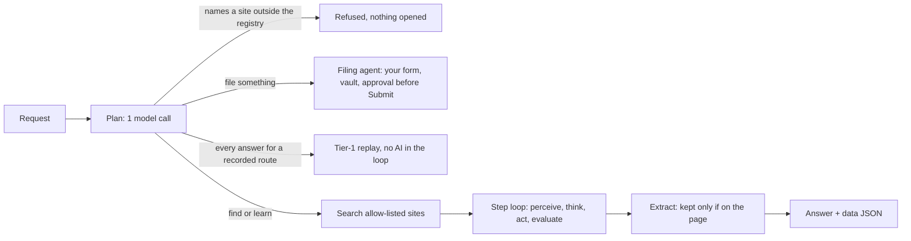
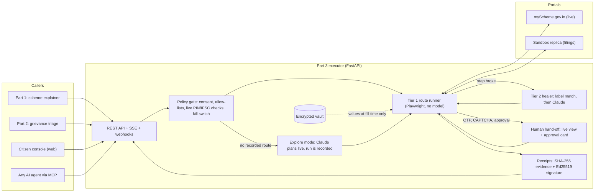
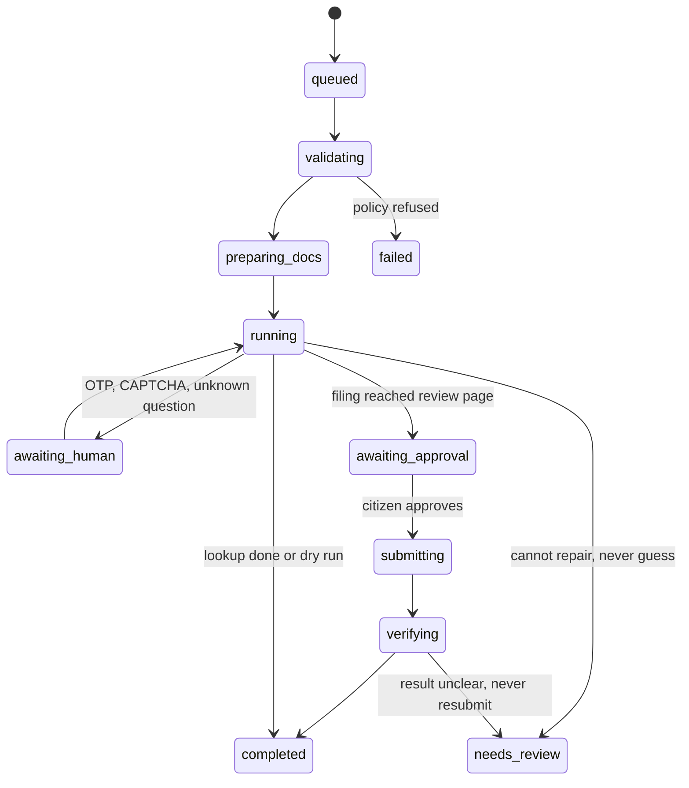

# Civic Pulse · Part 3: the assisted execution agent

Citizens lose days to government portals: multi-page wizards, OTPs, CAPTCHAs,
strict upload limits and sessions that time out. This agent drives those portals
in a real browser on the citizen's behalf, asks the citizen only for what must be
theirs (OTP, CAPTCHA, the final "yes"), and returns a signed receipt.

**Assisted, not autonomous: a human approves every submission.**

- **Real portal, real data.** It answers the live [myScheme.gov.in](https://www.myscheme.gov.in/find-scheme) eligibility questionnaire and returns the portal's own scheme list.
- **Plans with AI, then runs without it.** On a portal it has never seen, Claude plans each screen with visible reasoning. The run is recorded as a route, and later runs replay it with zero model calls.
- **Repairs itself.** When a portal changes, a two-stage healer fixes the broken step (label match first, then Claude) and saves a route patch for review.
- **Safe by construction.** The model chooses *where* to act, never *what* to type. It cannot leave the portal, press Submit or Pay, or see a bank number.

## The web app

One React app (`web/`) for the whole of Civic Pulse, served by the same server:

| Page | Part | What it does |
|---|---|---|
| `/` | all | Government-style home: hero, the three services, how it works, live stats from real runs |
| `/schemes` | 1 | Ask in your language (speech input, 6 languages), answer with sources, eligibility and voice; the live myScheme finder |
| `/schemes/engine` | 1 | Animated explainer pipeline with per-stage timing |
| `/grievance` | 2 | Photo, voice note, GPS or PIN code (live India Post check), auto-routing, AI triage, filing through the agent |
| `/board` | 2 | Public accountability board: stats, map, kanban, live agent follow-ups |
| `/agent` | 3 | The agent console: ask anything in plain words; suggestion chips; recent runs; guardrails |
| `/agent/runs/<run>` | 3 | One run, live or recorded: step list with each step's agent state (evaluation, memory, next goal, action), live browser and per-step screenshots, verified data with JSON copy, approval checkpoint, replay at 1×/2×/5× |
| `/agent/history` | 3 | Every run: title, how it ran, status, steps, time, AI calls |
| `/citizen/<task>` | 3 | The agent room: live browser, plain-language activity log, AI reasoning cards, OTP/CAPTCHA hand-off, approval sheet, signed receipt |

Light, official look for citizens (tricolor strip, accessibility bar with text size
and हिन्दी, original logo, glass and clay surfaces, original illustrations); a dark
"mission control" agent room. Part 1 and Part 2 screens connect to your
teammates' services through [docs/UI_CONTRACT.md](docs/UI_CONTRACT.md) and show an
honest "not connected yet" panel until then; they never show made-up data. The
logo is original: the national emblem is not used (its use is restricted by the
State Emblem of India (Prohibition of Improper Use) Act, 2005).

## The agent console (free-form requests)

Type any request. One model call plans it, then code decides the path:



- **Search.** DuckDuckGo's HTML results first (no key), restricted to allow-listed sites. If DuckDuckGo shows its bot check, the run says so and uses the site's own search page instead. The check is never solved or bypassed. In our tests on 31 Oct 2026 DuckDuckGo blocked every automated request, so the official site search is what actually ran.
- **Each step** is stored with a screenshot and the model's state (`previous_goal`, `eval`, `memory`, `next_goal`, `action`) and streamed to the page over SSE.
- **Guarantees in code:** the browser cannot open a site outside the registry; the model may type only words from the request or its search keywords; final-submit buttons wait for the citizen's Approve and payment buttons are never pressed; an extracted item is kept only if its name is on the page and its link was on the page; long numbers and emails are removed from the request before anything is stored or sent.
- **Replay** in the run view re-plays a recorded run's real steps and screenshots at 1×, 2× or 5×, always labelled "REPLAY of a run recorded <time>". There is no mode that passes a recording off as live.

Measured live on 31 Oct 2026 (Claude Opus 5.5 via AIML API):

| Request (typed fresh, not in the code) | Path | Steps | Time | AI calls | Result |
|---|---|---|---|---|---|
| "Is there a pension for elderly people with disabilities, and who qualifies for it?" | search, open scheme page, extract | 7 | 34 s | 6 | IGNDPS with eligibility and amounts read from its page |
| "What help can a fisherman in Kerala get for buying a boat or nets?" | search, extract | 13 | 66 s | 12 | 4 schemes with links |
| Widowed SC woman farmer, rural Bihar, full profile | Tier-1 replay of the myScheme finder | 23 | 10 s (4.5 s replay) | 1 | 92 schemes, first 10 listed |
| "Book a train ticket … on irctc.co.in" | refused | 2 | 3.5 s | 1 | out of scope |

## Architecture





How one task flows:
1. **Policy gate.** Checks consent and the input allow-list. IFSC codes and PIN codes are checked live against RBI and India Post data.
2. **Document prep.** Shrinks photos and scans to the portal's limits.
3. **Tier 1 replay.** A recorded route (YAML) is replayed. Every step has a postcondition.
4. **Tier 2 repair.** If a step breaks, the healer repairs it: label match first, then Claude.
5. **Explore.** If there is no route, Claude plans the run live and the run is recorded.
6. **Human hand-off.** The citizen types the OTP or CAPTCHA into a live view of the page, or answers a question the portal asked that we had no answer for.
7. **Approval and submit.** Filings stop for approval and submit exactly once.
8. **Receipt.** The receipt (reference number or live results) is signed and pushed to the caller.

## Where the data comes from (no dummy data)

| Data | Source | When |
|---|---|---|
| Scheme eligibility results | myScheme.gov.in, read live from the portal's own results page | Every lookup |
| District and state for a PIN code | India Post data via api.postalpincode.in | Console autofill and policy check |
| Bank and branch for an IFSC | RBI IFSC data via ifsc.razorpay.com | Console and policy check |
| Citizen details | Typed by the citizen in the console, or sent by Part 1/Part 2 | Every task |
| Filings (grievance, scholarship) | A sandbox replica portal with a visible "not a government website" banner | Filing demos |

Filings are never tested on real government portals: each one would be a real
grievance to a real ministry, or a real RTI request with a fee. The same agent
runs on real portals in dry-run mode (stopping before submit). Synthetic personas
exist only in `tests/fixtures/` for automated tests.

## Measured, not claimed

| Run | Agent time | Model calls | Source |
|---|---|---|---|
| Sandbox filing, Tier 1 (login, 4-page wizard, uploads) | 2.8 s median, 10/10 runs | 0 | `reports/eval-*.md` |
| Sandbox grievance, Tier 1 | 2.3 s median, 10/10 runs | 0 | `reports/eval-*.md` |
| Layout change: renamed field ids | repaired by label match | 0 | `reports/eval-*.md` |
| Layout change: relabelled field | repaired by Claude, 3.4 s | 1 | `reports/eval-*.md` |
| Layout change: new instructions page | repaired by Claude (2 detour clicks), 6.9 s | 2 | `reports/eval-*.md` |
| AI explore, sandbox form (first visit) | 5.5 s | 1 | `reports/eval-*.md` |
| AI explore, live myScheme (first visit, 6 screens) | 36.7 s | 9 | `reports/eval-*.md` |
| Same lookup, replaying the recorded route (live network) | 3.7–4.0 s median, 3/3 runs in each of two evals | 0 | `reports/eval-*.md` |

Agent time excludes the time spent waiting for the citizen. The model was
Claude Opus 5.5 at low effort, served through AIML API, measured on 31 Oct 2026.
In the injection test the model ignored the injected notice, and canary values
never appeared in any model request.

## Run it

```bash
uv sync
```

```bash
uv run playwright install chromium
```

```bash
npm --prefix web ci && npm --prefix web run build
```

Start the sandbox portal and the executor (two terminals):

```bash
uv run uvicorn sandbox_portal.app:app --port 8100
```

```bash
CIVIC_HEADLESS=0 uv run uvicorn executor.api:app --port 8000
```

Open http://127.0.0.1:8000, pick a service, enter details and consent. To work on
the UI with hot reload, also run `npm --prefix web run dev` and open http://127.0.0.1:5173
(it proxies the API to port 8000). For the
AI explore and repair features, put `AIMLAPI_KEY` (Claude through AIML API) or
`ANTHROPIC_API_KEY` in `.env`; the executor loads it at start-up. Settings are
listed in `.env.example`.

One container (Hugging Face Spaces or Render): see [docs/DEPLOY.md](docs/DEPLOY.md).

## Use it from Part 1, Part 2 or any agent

- **REST:** `POST /v1/tasks` and friends, with SSE events and HMAC-signed webhooks. See [docs/INTEGRATION.md](docs/INTEGRATION.md). OpenAPI at `/docs`.
- **SDKs:** one-file clients in [clients/python](clients/python/civic_part3.py) and [clients/js](clients/js/civic-part3.mjs).
- **MCP:** `uv run python -m executor.mcp_server` exposes `find_schemes`, `start_application`, `get_task`, `list_services` and `verify_receipt` to any MCP client.
- **Contracts:** JSON Schema for the five shared objects in [contracts/](contracts/).

## Tests

```bash
uv run pytest -q -m "not live"
```

```bash
uv run pytest -q -m live
```

```bash
uv run python scripts/eval.py --runs 10
```

| Test file | What it proves |
|---|---|
| `test_e2e.py` | Both filings end to end; dry run never submits; a wrong CAPTCHA recovers without double filing; rejection; session expiry fails safe; idempotency; receipt tamper detection |
| `test_heal_security.py` | Renamed ids healed with no model; relabelled field and new interstitial page healed by the model loop; injected notice ignored and logged; an obedient model is contained by policy; canary values never reach model requests, events or evidence |
| `test_explore.py` | AI explore records a route that replays for a different citizen with zero model calls; poisoned links blocked; invented values refused |
| `test_live_portal.py` | Real myScheme: two answer branches, an empty result, AI explore then replay; live India Post and IFSC APIs |
| `test_policy_units.py` | Consent, allow-listed inputs, live IFSC/PIN checks and outage fallback, draft routes, kill switch, document shrinking |
| `test_api.py` | The HTTP surface as Part 1/2 and the phone use it: API key, idempotency, live-view typing over WebSocket, approval, SSE replay, HMAC webhooks |

## Layout

```
web/                 the React app (Vite, TypeScript, Tailwind, Motion): every page above
executor/            the service
  api.py               REST, SSE, citizen endpoints, live-view websocket
  public_app.py        serves the web app; public endpoints (/app/*), proxies to Part 1/2
  console.py           agent console: planner, step loop, checked extraction, runs API (/app/agent/*)
  search.py            allow-listed web search (DuckDuckGo HTML, else the site's own search)
  worker.py            task lifecycle, receipts, patches and drafts
  policy.py            consent, allow-lists, live checks, rate limit, kill switch
  runner.py            Tier 1 route runner
  healer.py            Tier 2 repair and its action policy
  explorer.py          AI explore mode and route recording
  engines.py           swappable repair/explore engines
  snapshot.py          compact, relevance-ranked page state (values masked)
  enrich.py            live India Post and RBI IFSC lookups
  handoff.py           live view (CDP screencast) and approval gate
  vault.py, receipts.py, docprep.py, llm.py, mcp_server.py
registry/            portals and routes as YAML (myscheme, sandbox, cpgrams draft, rti_online off)
sandbox_portal/      the sandbox replica used for filings and resilience tests
clients/             Python and JavaScript SDKs for teammates
contracts/           JSON Schema for the shared objects
tests/, harness/     tests, simulated citizen, scripted models for offline tests
scripts/             eval, demo, contract export, patch promotion
deploy/, Dockerfile  container start-up and Hugging Face Space header
docs/                plan review, integration, deployment, submission text
```

## Honest limits

- CI tests use scripted stand-ins for the model; the real-model numbers above come from one `scripts/eval.py --llm` run. Re-run it before the final submission.
- myScheme's finder currently answers "No Schemes Found!" for the student profiles we tried (ages 19 and 20 in Bihar, 19 in Uttar Pradesh), while other profiles return results (a widowed farmer: 92; a construction worker: 3). We show the portal's own answer and do not invent results.
- The console's research path takes 30–70 s and 6–12 model calls per request; the recorded-route path takes about 10 s with 1.
- CPGRAMS and RTI Online are registered but locked (draft route, submission off) until a genuine filing is agreed.
- A receipt's signature proves the record was not changed after issue. It does not prove a portal accepted anything.
